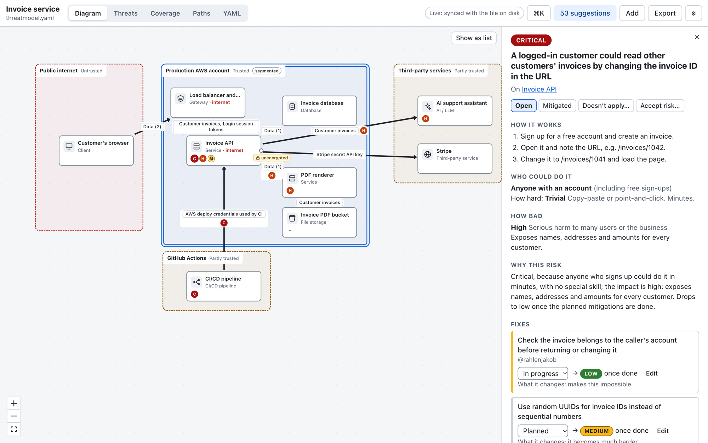
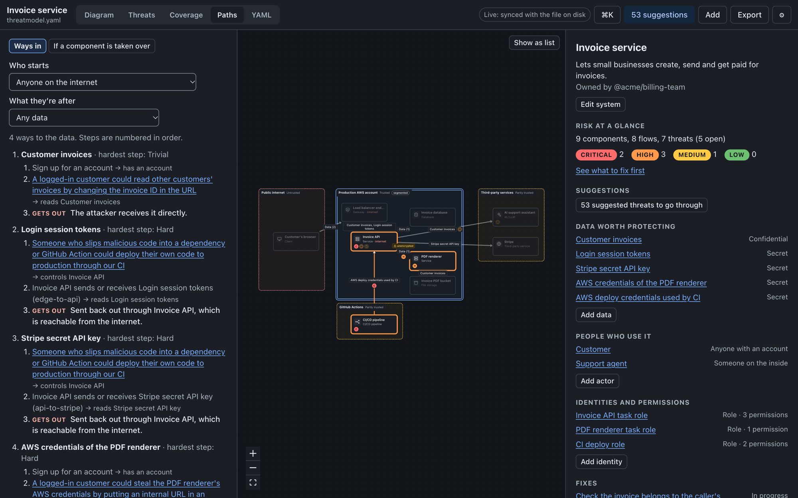

<div align="center">

# threat-model

**Threat modeling that developers actually do.**

A plain file in your repo. Threats explained the way a senior engineer would explain them. A diagram in your browser, a CLI for CI, and an MCP server so your coding agent keeps it all up to date.

[](https://github.com/open-security-tooling/threat-model/actions/workflows/ci.yml)
[](https://scorecard.dev/viewer/?uri=github.com/open-security-tooling/threat-model)
[](#built-like-a-security-tool)
[](LICENSE)
[](go.mod)

[**Try it in your browser**](https://open-security-tooling.github.io/threat-model/) · [Install](#install) · [60-second tour](#a-60-second-tour) · [Docs](#docs)

<br>

<picture>
  <source media="(prefers-color-scheme: dark)" srcset="docs/images/threat-card-dark.png">
  
</picture>

</div>

## Why

Most threat models are written once for a review, in a language developers don't speak, and never touched again. This one is built to be different:

| Usually | Here |
|---|---|
| *"Information Disclosure (STRIDE), CWE-639, CVSS 6.8"* | *"A logged-in customer could read other customers' invoices by changing the invoice ID in the URL."* The security mappings are still there, one click away. |
| A risk score with no reason | **Critical**, *because anyone who signs up could do it in minutes, with no special skill; the impact is high: exposes names, addresses and amounts for every customer.* |
| A desktop app, or a server you have to host | A file in your repo, a [zero-install web app](https://open-security-tooling.github.io/threat-model/) that never uploads anything, and a CLI |
| Out of date the week after the review | CI flags threats when the code they cover changes, and your coding agent updates the model in the same PR |
| A blank page | 84 threats from a built-in library, suggested for your stack and filled in with your component names |

## Install

```sh
brew install open-security-tooling/tap/threat      # macOS and Linux
go install github.com/open-security-tooling/threat-model/cmd/threat@latest   # CLI and MCP; web app not embedded
```

Or download a binary from [releases](https://github.com/open-security-tooling/threat-model/releases). Every release is built in GitHub Actions with signed build provenance, so you can check where a binary came from:

```sh
gh attestation verify threat_darwin_arm64 --repo open-security-tooling/threat-model \
  --signer-workflow open-security-tooling/threat-model/.github/workflows/release.yml
```

> The first release (v0.1.0) is on its way. Until then, build from source: `make web build-web` (needs Go and Node 22).

No install needed for the web app: [open it in your browser](https://open-security-tooling.github.io/threat-model/). It runs entirely on your machine (the Go core is compiled to WebAssembly) and never sends your model anywhere.

## A 60-second tour

```console
$ threat init --agents AGENTS.md        # a starter threatmodel.yaml, plus instructions for your coding agent
$ threat suggest                         # threats from the library that fit what you've described
$ threat explain read-others-invoices    # the plain-language card, with why it's this risk
$ threat paths                           # how an attacker could chain threats to reach your data
$ threat serve                           # the web app on this file, live-synced as you or an agent edit it
$ threat check --base origin/main        # in CI: what this change means for the threat model
```

### Explained risk, not scores

```console
$ threat explain read-others-invoices
CRITICAL  A logged-in customer could read other customers' invoices by changing the invoice ID in the URL
   read-others-invoices · open · affects Invoice API

How it works
  1. Sign up for a free account and create an invoice.
  2. Open it and note the URL, e.g. /invoices/1042.
  3. Change it to /invoices/1041 and load the page.

Who could do it: anyone with an account, including free sign-ups
How hard: trivial (minutes, tools exist)
How bad: high. Exposes names, addresses and amounts for every customer.

Why this risk: Critical, because anyone who signs up could do it in minutes, with no special skill; the impact is high: exposes names, addresses and amounts for every customer. Drops to low once the planned mitigations are done.

Fixes
  [~] Check the invoice belongs to the caller's account before returning or changing it (in-progress: critical → low once done; makes this impossible)
  [ ] Use random UUIDs for invoice IDs instead of sequential numbers (planned: critical → medium once done; it becomes much harder)
```

Risk comes from three questions anyone can answer (who could do it, how hard, how bad) and two small, published [tables](docs/risk.md). Every level comes with the sentence that explains it.

### See how attacks chain together



A list of threats doesn't show how they combine. `threat paths` simulates an attacker moving through your model, using your zones, network segmentation, outbound access and service identities. It shows each way in as a short story, says how the data would get out, and ranks the fixes that cut the most paths. Pick a component to see its blast radius if it were compromised.

### Built for agents and CI

The model is one YAML file with a [published JSON Schema](schema/v1.json), stable IDs and comment-preserving formatting, so agent edits are small, reviewable diffs.

- **MCP server (`threat mcp`):** agents can read the model, suggest threats, update fixes and find attack paths. Every write is validated, and an invalid one leaves the file untouched. Changes that make the model look safer are refused unless a person allows them: deleting or dismissing serious threats, downgrading them, overriding risk, accepting risk, recording reviews.
- **`threat check --base origin/main`:**
  - flags threats whose code changed since they were last reviewed
  - catches fixes whose evidence disappeared from the code, and expired risk acceptances
  - flags every change that lowers risk, so a model can't quietly be weakened
- **Output for CI:** `--format github` gives annotations, `--format sarif` gives code-scanning alerts, and `--format summary` gives a PR comment. A [GitHub Action](action/) wraps it, and verifies the `threat` binary before running it.

### For security teams

Security teams get enforcement without making developers learn security vocabulary:
- **A policy file,** [`.threat.yaml`](docs/policy.md), that they own through CODEOWNERS. It can:
  - fail CI on open critical risks
  - name approvers for risk-lowering changes
  - cap how long a risk acceptance lasts
  - require evidence, tests, due dates and sign-off
- **A reviewer view** in the web app, with a risk register (CSV/JSON export) and a sign-off panel.
- **Security mappings** (STRIDE, CWE, OWASP, CAPEC) on library entries, ready for audits.

## What's in a model

```yaml
# threatmodel.yaml
version: 1
system:
  name: Invoice service
  tenancy: multi

identities:
  - id: api-role
    name: Invoice API task role
    kind: role
    can: [{do: read, on: api}]

components:
  - id: api
    name: Invoice API
    kind: service
    exposure: internet
    features: [login, password-reset, export]
    identity: api-role # what it can reach if it's ever compromised
    code: ["internal/invoice/**"] # CI flags its threats when this code changes

threats:
  - id: read-others-invoices
    title: A logged-in customer could read other customers' invoices by changing the invoice ID in the URL
    kind: leak
    affects: [api]
    attack:
      - Sign up for a free account and create an invoice.
      - Change the invoice ID in the URL to a neighbour's.
    who: any-user
    effort: trivial
    impact: high
    status: open
    mitigations: [check-invoice-owner]

mitigations:
  - id: check-invoice-owner
    title: Check the invoice belongs to the caller's account before returning it
    status: in-progress
    effect: eliminates
    evidence:
      - test: internal/invoice/handler_test.go#TestGetInvoice_OtherAccount # checked in CI
```

The file also records the protections you already have: WAFs and gateways, network segmentation, outbound limits, encryption in transit and at rest, service identities and their permissions, monitoring and patching. The [full example](docs/examples/invoice-service.threatmodel.yaml) shows them all, and the [format reference](docs/model-format.md) explains each field.

## Built like a security tool

A threat model is a map of your weak spots, so the tool treats it that way:

- **Your model stays with you.** No server, no accounts, no telemetry. The web app has a strict Content-Security-Policy that blocks every outbound connection, and the local server only listens on 127.0.0.1, behind a per-run token and Host/Origin checks.
- **Untrusted input is expected.** Model files arrive in pull requests:
  - YAML anchors, aliases and tags are rejected, and there are size and depth limits
  - the parser and the editor are fuzzed in CI
  - file paths can't escape the repository
  - model text is never rendered as HTML
- **Supply chain.**
  - Only GitHub-owned and verified Actions, pinned to commit SHAs.
  - Dependencies are few and pinned, and Dependabot waits 7 days before adopting a new version.
  - CI runs CodeQL, dependency review, `govulncheck`, `npm audit` and OpenSSF Scorecard.
  - Releases come from signed tags, with build provenance and an attested SBOM (SLSA Build L2; L3 is [next](docs/roadmap.md)).
- **We use it on ourselves.** This repo's own [`threatmodel.yaml`](threatmodel.yaml) is checked in CI, with evidence pointing at the code that implements each defence. [docs/security.md](docs/security.md) walks through it.

## How it works

```
                 threatmodel.yaml   ← lives in your repo, reviewed in PRs
                 ▲      ▲      ▲
       ┌─────────┘      │      └──────────┐
       │                │                 │
   Web app           threat CLI      threat mcp
 (browser, WASM)   (you, CI)       (your agents)
       │                │                 │
       └────────────────┴─────────────────┘
          one Go core: parse, validate, explain risk,
          suggest threats, simulate, check, edit
```

One Go core powers all three, so a model behaves the same everywhere. The web app is React and TypeScript. All model logic runs in the core, compiled to WebAssembly, so the UI never edits YAML itself.

## Docs

| | |
|---|---|
| [Concepts](docs/concepts.md) | Components, flows, zones, threats and controls, in dev terms |
| [Model format](docs/model-format.md) | Every field in `threatmodel.yaml` |
| [Risk](docs/risk.md) | How risk is scored and explained |
| [Threat library](docs/threat-library.md) | The built-in catalogs, and how to write your own |
| [Simulation](docs/simulation.md) | Attack paths, exfiltration, blast radius |
| [Agents and CI](docs/agents.md) · [CI setup](docs/ci.md) | The CLI, MCP server, `threat check` and the GitHub Action |
| [Policy](docs/policy.md) | `.threat.yaml` for security teams |
| [Web app](docs/web-app.md) | The browser app |
| [Architecture](docs/architecture.md) · [Security](docs/security.md) · [Principles](docs/principles.md) · [Roadmap](docs/roadmap.md) | How it's built and why |

## How it compares

| Tool | What it does well | Where threat-model differs |
|---|---|---|
| [OWASP Threat Dragon](https://owasp.org/www-project-threat-dragon/) | Free, open diagramming | Threat-model leads with plain language and explained risk, not STRIDE labels |
| [Gram](https://github.com/klarna-incubator/gram) (Klarna) | Suggestions from your tech stack, reviews for security champions | Gram needs a server, a database and SSO. Threat-model is a file in your repo, and review happens in PRs. |
| [Threagile](https://github.com/Threagile/threagile) | YAML models with risk rules, in Go | Threat-model is built for everyday editing by developers and agents, not just reports |
| [pytm](https://github.com/OWASP/pytm), [threatcl](https://github.com/threatcl/threatcl) | Models as code | Threat-model needs no Python or HCL, and adds a visual editor |

## Contributing

Issues and pull requests are welcome; see the [contributing guide](https://github.com/open-security-tooling/.github/blob/main/CONTRIBUTING.md). New threat library entries are especially welcome. [docs/threat-library.md](docs/threat-library.md) explains the format and the writing rules.

To report a vulnerability, please use [private vulnerability reporting](https://github.com/open-security-tooling/threat-model/security/advisories/new), not a public issue. See the [security policy](https://github.com/open-security-tooling/.github/blob/main/SECURITY.md).

## License

[Apache-2.0](LICENSE)
